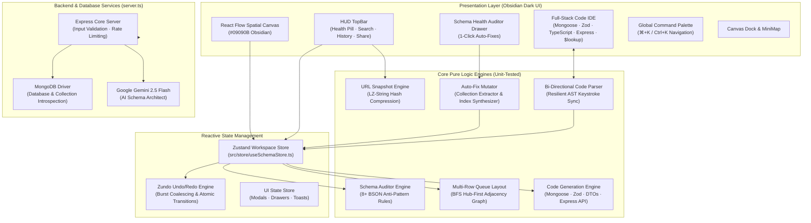

<div align="center">

# SchemaFlow

**The Developer-First Visual MongoDB Architecture Engine & Anti-Pattern Auditor**

*Design, audit, simulate, and export production-ready full-stack database architectures with real-time anti-pattern detection and bi-directional code synchronization.*

[](https://www.typescriptlang.org/)
[](https://react.dev/)
[](https://www.mongodb.com/)
[](https://zod.dev/)
[](https://vitejs.dev/)
[](https://vitest.dev/)
[](LICENSE)

---

### [Live Demo](#quick-start) · [Architecture](#system-architecture) · [Anti-Pattern Auditor](#1-real-time-mongodb-anti-pattern-auditor) · [Code Engine](#3-full-stack-code-engine--sandbox) · [Command Palette](#5-global-command-palette--shareable-snapshots)

</div>

<br />

<!-- ======================================================================= -->
<!-- HERO MEDIA SECTION -->
<!-- ======================================================================= -->

## 📸 Media & Interactive Showcase

> [!TIP]
> **Recording Guide for Portfolio & Competition Submissions**:
> - **Hero Screenshot**: Frame the canvas at 1920×1080 with the default **Multi-Tenant SaaS** blueprint loaded, the amber **Health Badge (70%)** visible, and the **Code Drawer** open to the **Mongoose** tab showing bidirectional line highlights.
> - **15-Second Demo GIF**:
>   1. `0:00 - 0:04`: Click the **Health 70%** pill in the top bar to open the Auditor.
>   2. `0:04 - 0:08`: Click **"1-Click Fix"** on the *Unbounded Array* issue; watch the `Comments` collection extract and health score jump to **85%**.
>   3. `0:08 - 0:11`: Hit `⌘+K`, select **"Load Blueprint: E-Commerce & Inventory"**, and watch the smooth multi-row glide.
>   4. `0:11 - 0:15`: Switch Code Drawer to **"Query Sandbox"** to showcase the instant `$lookup` aggregation pipeline.

```
┌────────────────────────────────────────────────────────────────────────────────────────┐
│                                HERO SCREENSHOT SLOT                                    │
│       [ Replace with: docs/assets/hero-screenshot.png — 1920x1080 Obsidian Canvas ]    │
└────────────────────────────────────────────────────────────────────────────────────────┘
```

```
┌────────────────────────────────────────────────────────────────────────────────────────┐
│                                 15s DEMO GIF SLOT                                      │
│       [ Replace with: docs/assets/demo-walkthrough.gif — 1280x720 30fps Clean Loop ]   │
└────────────────────────────────────────────────────────────────────────────────────────┘
```

---

<!-- ======================================================================= -->
<!-- THE PROBLEM & VALUE PROPOSITION -->
<!-- ======================================================================= -->

## 💡 The Problem: Relational Thinking in Document Databases

Traditional ER diagram tools treat MongoDB collections like SQL tables with rigid foreign keys. In reality, MongoDB architectures succeed or fail based on **document growth limits (16MB BSON)**, **index coverage during `$lookup` aggregation stages**, and **write amplification on nested subdocuments**:

1. **Unbounded Array Trap**: Developers embed arrays of comments, activity logs, or orders directly inside a parent document. As traffic scales, documents hit MongoDB's 16MB limit or cause continuous disk fragmentation.
2. **`COLLSCAN` Nightmares**: Foreign key references without secondary indexes trigger full collection scans (`COLLSCAN`) during `$lookup` joins, stalling production replica sets.
3. **Sensitive Field Leaks**: Passwords and private API tokens without `select: false` accidentally serialize to API clients.
4. **Schema-to-Code Desync**: Visual designs drift from actual Mongoose, Zod, and Express boilerplate.

**SchemaFlow solves this** by pairing a spatial, GPU-accelerated canvas with a **real-time MongoDB Anti-Pattern Auditor**, **1-Click Auto-Fixes**, and an **interactive `$lookup` sandbox**.

---

<!-- ======================================================================= -->
<!-- SYSTEM ARCHITECTURE -->
<!-- ======================================================================= -->

## 🏗️ System Architecture

SchemaFlow is built as a pure, decoupled engineering system. Pure business logic (graph layout, AST parsing, schema auditing, code generation) remains isolated in testable TypeScript modules, while reactive state is orchestrated by Zustand and Zundo.



---

<!-- ======================================================================= -->
<!-- KEY ENGINEERING HIGHLIGHTS -->
<!-- ======================================================================= -->

## 🚀 Key Engineering Highlights

### 1. Real-Time MongoDB Anti-Pattern Auditor
SchemaFlow continuously analyzes the schema graph and calculates a **0–100 Schema Health Score** with actionable findings:
- **`UNBOUNDED_ARRAY` (Critical)**: Flags arrays of ObjectIds or subdocuments likely to grow infinitely (e.g., `comments`, `logs`, `notifications`), risking the 16MB BSON document limit.
- **`MISSING_FK_INDEX` (Warning)**: Flags referenced foreign keys that lack secondary indexes, preventing full collection scans (`COLLSCAN`) during `$lookup`.
- **`MISSING_TIMESTAMPS` (Warning)**: Ensures operational auditability with `createdAt` and `updatedAt`.
- **`MISSING_TTL_INDEX` (Warning)**: Identifies transient collections (`sessions`, `tokens`, `logs`, `otp`) lacking automatic time-to-live expiration.
- **`MISSING_UNIQUE_INDEX` (Warning)**: Detects natural identifiers (`email`, `username`, `slug`, `sku`) without unique constraints.
- **`SENSITIVE_FIELD_EXPOSED` (Critical)**: Warns when fields like `passwordHash` or `secret` lack `select: false`.
- **`DEEP_NESTING` (Warning)**: Flags nested subdocument structures deeper than 3 levels to prevent write amplification.
- **`ORPHAN_COLLECTION` (Info)**: Highlights disconnected entities in multi-collection schemas.

#### 1-Click Auto-Fix Engine
Issues are not just reported; they are **programmatically remediated** with a single click. For example, fixing an `UNBOUNDED_ARRAY` automatically:
1. Extracts the array into a brand new child collection.
2. Synthesizes a primary key `_id` and an indexed foreign key referencing the parent collection.
3. Removes the offending array from the parent.
4. Triggers the relationship-aware multi-row auto-layout pass as a single atomic undo/redo step!

```
┌─────────────────────────────────────────────────────────────┐
│ 🔴 Critical Issue: Unbounded Array on "comments"            │
│ MongoDB Impact: BSON 16MB limit failure and disk relocation.│
│ [ ⚡ 1-Click Fix: Extract to Linked Child Collection ]       │
└─────────────────────────────────────────────────────────────┘
```

---

### 2. Relationship-Aware Multi-Row Queue Layout
Unlike standard generic hierarchical algorithms (such as Dagre) that stretch schemas into giant single-row ribbons or awkward single vertical towers, SchemaFlow implements a custom **Queue-Grid Algorithm**:
1. **Adjacency & Connectivity**: Identifies connected components and isolates high-degree "hub" nodes (collections with the highest number of relationships).
2. **BFS Traversal**: Traverses the graph via Breadth-First Search so tightly linked collections land adjacent in the queue.
3. **Balanced Column Rule**:
   - 1–3 collections: up to 3 columns (1 row).
   - 4 collections: clean 2×2 grid.
   - 5–9 collections: 3 columns per row (e.g., 5 cards = 3 on Row 1, 2 on Row 2).
   - 10+ collections: 4 columns per row.
4. **Dynamic Card Height & Row Stagger**: Measures exact node heights (including variable field rows and badges) and applies uniform row baselines (`GAP_X = 96px`, `GAP_Y = 88px`) to guarantee zero edge crossings and zero overlaps.

---

### 3. Full-Stack Code Engine & Sandbox
The built-in resizable Code IDE provides instant compilation for 6 targets:
- **Mongoose Schema (TypeScript)**: Fully typed schemas with secondary indexes, compound indexes, TTL expiration options, `select: false`, and virtuals.
- **Zod Validation Schemas**: Generates strict `Create<Model>Schema` and `Update<Model>Schema` with ObjectId hex regex, email validators, and numeric min/max bounds.
- **TypeScript DTOs**: Clean interface definitions separating entity models from creation payloads.
- **Express + TypeScript CRUD Controller**: Production-ready REST routers wired with Zod schema validation middleware.
- **MongoDB Native `$jsonSchema`**: Production migration scripts with `$jsonSchema` document validators and `db.collection.createIndex()` commands.
- **Realistic Mock Data Generator**: Generates realistic sample JSON documents with linked foreign keys based on field names and semantic data types.

#### Interactive `$lookup` Aggregation Sandbox
Click any two connected collections (or click a relationship edge) to immediately synthesize an optimized 4-stage pipeline:
```javascript
// MongoDB Aggregation Pipeline: Orders → Users
db.orders.aggregate([
  // Stage 1: Filter
  { $match: {} },

  // Stage 2: Join with parent Users
  {
    $lookup: {
      from: 'users',
      localField: 'userId',
      foreignField: '_id',
      as: 'user',
    },
  },

  // Stage 3: Projection for zero-copy efficiency
  {
    $project: {
      totalAmount: 1,
      createdAt: 1,
      user: 1,
    },
  },
]);

// Performance Advisory:
db.orders.createIndex({ userId: 1 }); // Guarantees IXSCAN over COLLSCAN
```

---

### 4. Bi-Directional Canvas-to-Code Sync
Edit Mongoose schema code directly in the IDE tab! SchemaFlow includes a resilient parser ([mongooseParser.ts](file:///c:/New%20folder/coding/ProjectForResume/SchemaFlow/SchemaFlow/src/utils/mongooseParser.ts)) that:
- Syncs field additions, type modifications, required flags, indexes, and foreign key references back to the visual canvas nodes.
- Preserves canvas positions, custom color tags, and internal node IDs when model names match.
- Handles partial keystrokes and incomplete syntax gracefully without throwing runtime errors or disrupting focus.

---

### 5. Global Command Palette & Shareable Snapshots
- **Command Palette (`⌘+K` / `Ctrl+K`)**: Rapid keyboard navigation to jump directly to any collection or field, toggle code panes, run auto-layout, or load blueprints.
- **Zero-Backend Resume Sharing**: Clicking **Share** compresses the entire schema architecture into an URL hash fragment using `lz-string` (`#schema=...`). Anyone clicking the link opens your exact schema architecture immediately with zero server storage overhead.

---

<!-- ======================================================================= -->
<!-- PRE-BUILT BLUEPRINTS -->
<!-- ======================================================================= -->

## 📦 Pre-Built Production Blueprints

Never start on a blank screen. SchemaFlow includes 4 production blueprints accessible from the Command Palette or on first startup:

| Blueprint | Key Collections | Purpose / Demo Highlight |
| :--- | :--- | :--- |
| **Multi-Tenant SaaS** *(Default)* | `Organizations`, `Users`, `Subscriptions`, `Projects`, `AuditLogs` | Pre-configured with intentional BSON anti-patterns to demonstrate the Schema Health Auditor & 1-Click Fix. |
| **E-Commerce & Inventory** | `Users`, `Products`, `Orders`, `Reviews`, `Carts` | Clean e-commerce schema with strict secondary indexes and composite queries. |
| **Real-Time Chat & Collab** | `Workspaces`, `Channels`, `Messages`, `Users` | High-throughput messaging schema with channel-scoped indexes and user status enums. |
| **EdTech / LMS Platform** | `Students`, `Courses`, `Modules`, `Enrollments`, `Submissions` | Multi-tier educational platform with progress tracking and submission scores. |

---

<!-- ======================================================================= -->
<!-- QUICK START -->
<!-- ======================================================================= -->

## ⚡ Quick Start

### Prerequisites
- [Node.js](https://nodejs.org/) v18.0.0 or higher
- [npm](https://www.npmjs.com/) v9.0.0 or higher

### 1. Clone & Install Dependencies
```bash
git clone https://github.com/your-username/SchemaFlow.git
cd SchemaFlow
npm install
```

### 2. Configure Environment Variables
Copy [.env.example](file:///c:/New%20folder/coding/ProjectForResume/SchemaFlow/SchemaFlow/.env.example) to `.env`:
```bash
cp .env.example .env
```

Edit `.env` (optional, for AI features):
```env
PORT=3000
NODE_ENV=development

# Optional: Required only for Gemini AI Schema Architect (/api/generate-schema)
# Get a free key at https://aistudio.google.com/
GEMINI_API_KEY=your_gemini_api_key_here
```

### 3. Launch Development Server
```bash
npm run dev
```
Open [http://localhost:3000](http://localhost:3000) in your browser.

### 4. Run Automated Test Suite
```bash
npm test
```
Runs 27 thorough unit tests covering the **Schema Auditor**, **Code Generators**, and **Bi-Directional Mongoose Parser** with 100% pass rate.

### 5. Production Build
```bash
npm run build
npm start
```
Bundles client assets with Vite and compiles the hardened Express backend with esbuild to `dist/server.cjs`.

---

<!-- ======================================================================= -->
<!-- TECH STACK -->
<!-- ======================================================================= -->

## 🛠️ Tech Stack & Dependencies

- **Canvas & Spatial Graph**: `@xyflow/react` (React Flow 12), customized bezier curves, custom node renderers.
- **Frontend Framework**: React 19, TypeScript 5.8 (Strict Mode), Vite 6.
- **Styling**: Tailwind CSS v4, custom Obsidian Dark developer theme (`#09090B` canvas, `#121216` elevated surfaces).
- **State & History**: `zustand` v5, `zundo` (time-travel history with burst coalescing).
- **Validation & Parsing**: `zod` v3, custom Mongoose regex/AST parser.
- **Syntax Highlighting & Compression**: `prism-react-renderer`, `lz-string`, `jszip`.
- **Backend & Database**: Express 4, `mongodb` native driver (with strict connection timeouts & credential sanitization), `@google/genai` (Gemini 2.5 Flash).
- **Testing**: `vitest` v5.

---

## 📄 License

MIT © [SchemaFlow Contributors](LICENSE)
